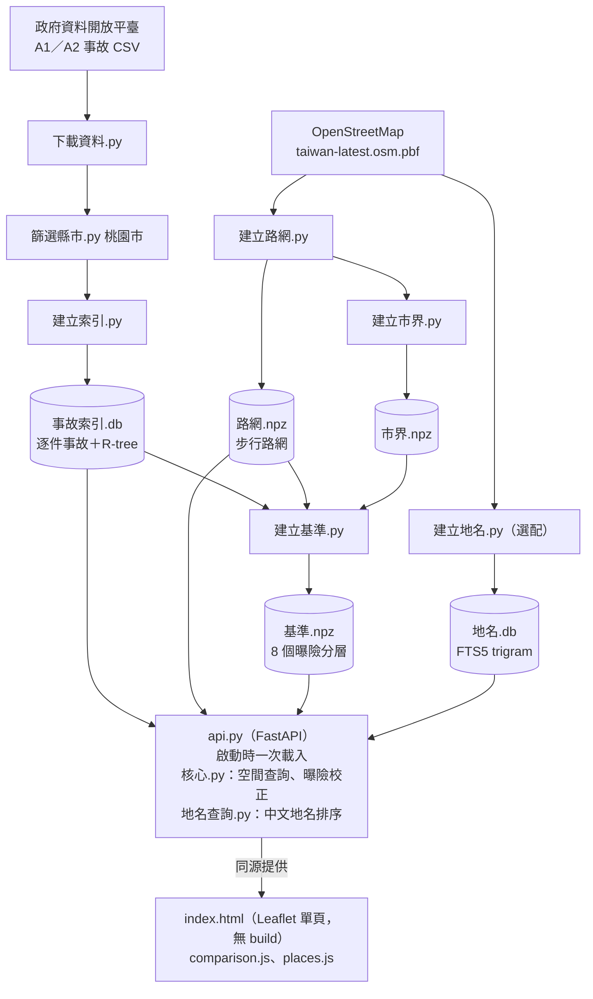

# Life House 安居指數

> 在桃園市地圖上選一個地點，看周邊 500 公尺走路生活圈的歷史行人事故風險：事故集中路口、經曝險校正的相對安全百分位、風險構成與每月趨勢。

> **這是團隊專案的個人延伸版本（fork）。** 原始團隊專案為 [lee851104/life_house](https://github.com/lee851104/life_house)；風險模型與資料管線由組員完成，我的貢獻範圍見下方「[我負責的部分](#我負責的部分)」。

## 要解決的問題

找房時查得到價格、格局和通勤時間，卻很難知道住家周邊步行範圍過去是不是事故熱點。

原始資料是公開的，但不好用：政府資料開放平臺的 A1／A2 事故 CSV 有 51 欄、數百萬列，**每一列是一名當事人而不是一件事故**，直接 count 會嚴重高估，檔尾還夾著非資料的註記列。而且「附近有 N 件事故」本身沒有意義——市區路多人多，事故自然多；山區路少，看起來永遠安全。所以分數必須經過曝險校正，並和同類地區比較。

## Demo

- **競賽 Demo 影片**：<https://youtu.be/3uHAfHad2d0>
- **操作演示影片**：<https://github.com/user-attachments/assets/a27441d5-9210-4edc-8b5a-41411687d1a7>
- **線上 Demo**：<https://p215-2203-nb01.tail177cc6.ts.net>（跑在一台每晚斷電的實體機器上，預定每日 08:00–20:00 台北時間開放；2026-10-30 18:13 確認時無法連線，請以本機執行為準）


左側底色為每 200m 一格的局部安全百分位，圓圈數字是該路口的行人事故件數；右側是相對安全分數（例如 24% 代表比附近 24% 的區域安全）、資料充足度與 A1／A2 事故組成。上方可切換全天／上班／下班／深夜。

> 分數是桃園市同類地區之間的相對百分位，**不是官方安全評等**，不能用來預測未來事故，也不構成不動產或保險決策建議。詳見 [MODEL_CARD.md](MODEL_CARD.md)。

## 架構



| 端點 | 用途 |
|---|---|
| `POST /api/v3/analyze` | 走路生活圈分析（座標 + 時段 → 分數、熱點、風險構成、趨勢） |
| `GET /api/v3/intersection` | 單一聚合位置底下的個別事故點 |
| `GET /api/v3/geocode` | 地址／地標／路口文字搜尋 |
| `GET /api/v3/meta` | 資料期間與筆數 |

技術：Python 3.13、FastAPI + Uvicorn、NumPy + SciPy（`cKDTree` 半徑查詢）、SQLite（R-tree、FTS5）、osmium + Shapely + PyProj（座標轉 EPSG:3826）、Leaflet 1.9.4、國土測繪中心 WMTS 底圖、uv + pytest + ruff + Playwright + GitHub Actions。

## 技術重點與設計決策

本專案**不是機器學習模型**，而是以規則與統計（距離核加權、曝險校正、百分位）產生相對風險；沒有使用 LLM。

- **先把「當事人」還原成「事故」**：`建立索引.py` 以「當事者順位 = 1」的列作為事故層級屬性來 group，`篩選縣市.py` 以 `^\d{4}$` 檢查首欄跳過檔尾註記列。
- **曝險校正**：風險 = Σ(行人事故嚴重度 × 時間權重 × K(d)) ÷ Σ(步行路網長度 × K(d))，K(d) 為 500m Epanechnikov 距離核；分子分母用同一個核，得到「每公里有效路網的事故負擔」。再依圈內可步行路網長度切 8 個曝險分層比較，小樣本另有收縮先驗（`walk_shrinkage_km`）。
- **用市界裁切取樣**：基準若用經緯度矩形取樣，約四分之三的點會落在新北、新竹或海上，被當成零事故而拉低整條分布；因此只在桃園市界內取樣。
- **參數用量測決定**：5 年窗 vs 2 年窗，零事故格比例 58.9% → 46.3%（25,471 個 200m 有效格，[reports/五年行人事故評估.json](reports/五年行人事故評估.json)）。
- **自建中文地理編碼**：Google Places 的 ToS 要求顯示在 Google 地圖上、Nominatim 公共服務禁止 autocomplete 類高頻查詢，所以用 SQLite FTS5 trigram 建索引；可搜尋單位選「路段／POI／路口」（44,385 筆），約 105 萬筆門牌另存非 FTS 表精確查詢。
- **公式只有一份**：風險公式只在 [src/features/risk.py](src/features/risk.py)，查詢、基準與建庫都呼叫它，測試也驗證正式路徑真的呼叫共用函式。
- **Windows 相容**：libosmium 開不了含中文的路徑，[src/data/osm_path.py](src/data/osm_path.py) 在開檔前接一個純 ASCII 的暫存硬連結；`.bat` 必須是純 ASCII + CRLF，中文訊息改由 [src/serving/launcher.py](src/serving/launcher.py) 印出。
- **對外展示不開放 0.0.0.0**：線上 Demo 用 [Tailscale Funnel](https://tailscale.com/kb/1223/funnel) 轉發到只綁 `127.0.0.1:8000` 的 uvicorn（`開機自動啟動.bat` 開機後檢查產物、埠與 Tailscale，並分別對本機與公開網址做健檢）。

## 成果與數字

**競賽**：本專案（團隊版本）進入 160 組參賽隊伍中的前 10 強。

資料範圍為桃園市、2021-07-01 至 2026-06-30，下表為 2026-09-02 重建的實測值（OSM 會更新、2026 年事故會補登，重建數字會有小幅差異）：

| 項目 | 數值 |
|---|---|
| 事故資料 | 231,449 件（A1 802 / A2 230,647） |
| 行人事故 | 11,726 件；實際計分 11,711 件（排除國道／高架／隧道 15 件） |
| 事故聚合位置 | 29,370 處（25m 網格 → 45m 貪婪聚合） |
| 步行路網 | 28,719 km |
| 比較基準 | 市界內 16,313 個取樣格、8 個曝險分層 |
| 地名搜尋 | 44,385 筆路段／POI／路口，另有 1,055,977 筆門牌 |
| 啟動載入 | 冷啟約 11 秒、熱啟約 4 秒 |

**測試**（2026-10-30 本機執行）：`pytest` 34 passed、`ruff check .` All checks passed、`node --test tests/test_comparison.cjs tests/test_places.cjs` 7 pass。Playwright E2E（`pnpm test:e2e`）需先下載 71 MB 測試資料包，這次未執行；CI 設定見 [.github/workflows/ci.yml](.github/workflows/ci.yml)。

## 如何執行

建置產物（索引、路網、基準、地名共約 153 MB）**不進版控**，由原始團隊 repo 的 [Release v1.0.0](https://github.com/lee851104/life_house/releases/tag/v1.0.0) 以單一 ZIP（71 MB）提供；本 fork 沒有另外發布 Release。

**路徑 A：下載建置產物（數分鐘）**

1. 下載 `lifehouse-data-v1.0.0.zip`，把裡面 5 個檔案放進專案根目錄（與 `啟動.bat` 同一層）。
2. 建立環境並啟動（需 Python 3.13）：

   ```bash
   python -m venv .venv
   .venv/Scripts/python.exe -m pip install -r requirements.txt
   .venv/Scripts/python.exe -m uvicorn src.serving.api:app --host 127.0.0.1 --port 8000
   ```

   Windows 也可以直接雙擊 `啟動.bat`，就緒後會開啟 <http://127.0.0.1:8000>。

**路徑 B：從政府開放資料重建（約一小時）**，需要 [uv](https://docs.astral.sh/uv/)，一律在專案根目錄以 `-m` 模組形式執行（原因見 [src/paths.py](src/paths.py)）：

```bash
uv sync --all-groups
uv run python -m src.data.下載資料
uv run python -m src.data.篩選縣市 桃園市
uv run python -m src.data.建立索引
uv run python -m src.data.建立路網      # 會先下載 PBF，順序不可調換
uv run python -m src.data.建立市界
uv run python -m src.models.建立基準
uv run python -m src.data.建立地名      # 選配，約 10 分鐘、需約 2 GB 記憶體
uv run uvicorn src.serving.api:app --host 127.0.0.1 --port 8000
```

有 `make` 的環境可用 `make setup / data / features / test / serve`。

**測試**：

```bash
uv run pytest
uv run ruff check .
pnpm install --frozen-lockfile && pnpm test
# E2E：先下載並驗證測試資料包，Playwright 會在 8010 埠啟動真正的 FastAPI
pnpm exec playwright install chromium
uv run python scripts/fetch_test_data.py
pnpm test:e2e
```

## 已知限制與下一步

- 歷史事故不預測未來；事故資料未含車流、人流與道路設計等曝險因子，密度偏低可能只反映使用量低。
- 2026 年屬當年度即時檔，會隨時間補登，不可直接與完整年度比較。
- 目前僅支援桃園市；市界邊緣仍會受界外路網與事故資料截斷影響。
- `POST /api/v3/analyze` 公開且運算密集，未實作速率限制，不適合長期公開曝露；展示機只在登入後啟動服務，鎖定畫面時公開網址無法使用。
- 分享連結不凍結分數，資料更新後結果可能不同；收藏只存在目前瀏覽器的 localStorage（最多 20 筆），不會同步。

## 我負責的部分

這是團隊競賽專案。**風險模型**（`src/models/核心.py`、`src/features/risk.py`、`src/models/建立基準.py`）與**資料管線**（`src/data/`）由組員 lee851104、chenliyu0410 負責，不是我的工作。

我的程式貢獻都在 upstream 的 [lee851104/life_house PR #3](https://github.com/lee851104/life_house/pull/3)「新增兩地比較、分享收藏、評分說明與完整流程測試」（2026-09-04 合併；6 個 commit 中 4 個由我提交，另 2 個是 lee851104 調整資料包下載連結）：

- **地點 A／B 比較與評分說明**：設定、命名、替換兩個地點，並排顯示安全百分位、行人事故、夜間占比與資料充足度；分數卡可展開查看比較對象與計算方式（`src/serving/static/comparison.js`、`src/serving/static/index.html`）。
- **分享連結與本地收藏**：網址 `#` 片段保留座標、名稱與時段，開啟後重新分析；瀏覽器本機收藏最多 20 筆（`src/serving/static/places.js`）。
- **路口統計修正**：`src/serving/api.py` 新增 `intersection_details`，用完整事故資料計算路口統計，不再被明細查詢的 400 筆上限截斷。
- **測試與 CI**：Playwright E2E（`tests/e2e/workflow.spec.cjs`，涵蓋「搜尋地址 → 選點 → 切換深夜 → 查看路口 → 返回」與分享、收藏流程）、Node 測試（`tests/test_comparison.cjs`、`tests/test_places.cjs`）、路口統計的 API 測試（`tests/test_walk_only_api.py`）、CI 擴充，以及下載並驗證 SHA-256 的測試資料包腳本 `scripts/fetch_test_data.py`。

影片製作：我製作前段 AI 影像並負責成片重新剪輯；後段 AI 影像由組員使用 Claude 生成。

## 資料來源與授權

- 事故資料：[政府資料開放平臺](https://data.gov.tw/)，提供機關內政部警政署。A1 為當場或 24 小時內死亡的事故；A2 為受傷或超過 24 小時死亡的事故。
- 路網與地名：© OpenStreetMap 貢獻者；底圖：國土測繪中心臺灣通用電子地圖 WMTS。
- 程式碼授權見 [LICENSE](LICENSE)。
